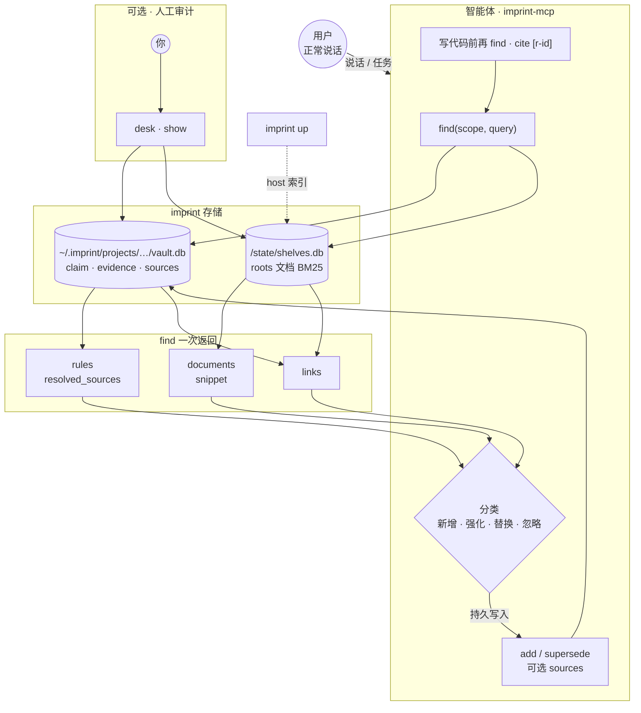
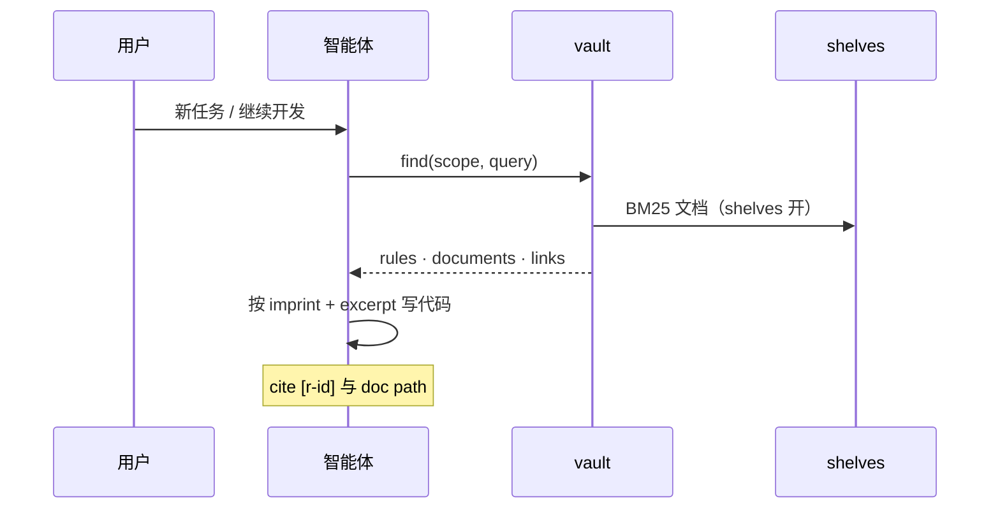

<div align="center">


# imprint

**面向智能体的项目策略长期记忆**

[English](README.md) · 中文

[](https://github.com/SteamedBread2333/imprint/releases)


</div>

日常对话会沉淀为可召回的规则：智能体每轮对话都会做分类，把规则与项目文档关联起来，写代码前再召回。**你正常说话即可，无需自己维护 vault。**

## 怎么工作

| | 何时 | 例子 |
| --- | --- | --- |
| **新增** | 新的长期偏好 | 命名规则、工作流、架构边界 |
| **强化** | 同一政策再次确认 | 「对，export 还是 PascalCase」 |
| **替换** | 政策变更 | 收窄或扩大 scope、改写 claim |
| **忽略** | 仅限本次任务 | 一次性重构、闲聊、密钥 |

用户否定已有规则（例如「别记了」）时，智能体先 `find` 再 `forget`。写入流程详见 [记忆写入](docs/correction.zh.md)。

Vault 保存 claim、evidence，以及可选的文档指针（`sources`）。Shelves 为 `roots` 下的 markdown 建立索引，一次 `find` 即可同时返回规则、snippet 和 links。

## 快速开始

```bash
go install github.com/SteamedBread2333/imprint/cmd/imprint@latest
go install github.com/SteamedBread2333/imprint/cmd/imprint-mcp@latest
cd your-project && imprint init
```

在编辑器中挂载 imprint MCP（见 [docs/mcp.zh.md](docs/mcp.zh.md)）。无法使用 MCP 时，可改用 CLI：`imprint --json`。

| | 你 | imprint |
| --- | --- | --- |
| **1** | 安装 + `init` | 写入 `imprint.yaml` 及各编辑器的规则文件（Cursor、Claude Code、Codex、Trae、Workbuddy） |
| **2** | 正常说话 | 智能体执行 `find`（vault + shelves）→ 分类 → `add` / `reinforce` 等（可选带 `sources`） |
| **3** | 浏览器审计（可选） | `imprint up` → `imprint desk open` |

<details>
<summary>智能体循环（flowchart）</summary>



</details>

<details>
<summary>写代码前召回（sequence）</summary>



</details>

## 存储

将 `imprint.yaml` 提交进 git（包含 roots、插件开关和可调参数）。私有运行时位于 **`~/.imprint/projects/<hash>/`**（`<hash>` 由仓库的绝对路径计算得出），不纳入 git。

默认 vault 的位置：从当前目录向上查找 `imprint.yaml`，并使用 `~/.imprint/projects/<hash>/`。可通过 yaml 中的 `vault:`、`--vault` 或环境变量 `IMPRINT_VAULT` 覆盖。未找到项目时，`--global` 会以当前目录套用同一套目录布局。

```
imprint.yaml            # 提交进 git：host、shelves.roots、plugins、supersede.inheritance_alpha
docs/                   # 常见的 shelves root
.cursor/rules/          # 常见的 shelves root

~/.imprint/projects/<hash>/   # 私有运行时（位于仓库外）
  project.root          # 指回本仓库（供 sources 与 MCP 使用）
  vault.db
  state/                # shelves.db · telemetry · plugins
  export/
```

Vault 与 shelves 均以 WAL 模式打开 SQLite，使 CLI、MCP 和 host 能够跨进程读写。`-wal` 与 `-shm` 文件属正常现象，imprint 运行期间请勿手动删除。

规则保存在 `vault.db` 中。ID 格式为 `r-YYYY-MM-DD-NNN`，状态包括 `active`、`dormant` 和 `superseded`。`supersede` 把旧规则标记为 `superseded`；`sweep` 将陈旧规则衰减为 `dormant`；`forget` 删除规则。交互式规则图可通过 **`imprint desk open`** 查看（数据来自 host 的 `GET /graph`）。

| | 运行位置 | 配置 |
| --- | --- | --- |
| **Shelves** | **host** | `shelves` · [imprint.yaml](docs/examples/imprint.yaml) |
| **Desk** | 外部插件 | `plugins.desk` · [imprint-desk-plugin](https://github.com/SteamedBread2333/imprint-desk-plugin) |
| **Embed** | 外部 sidecar（插件协议） | `~/.imprint/embed.yaml` · [imprint-embed-sidecar](https://github.com/SteamedBread2333/imprint-embed-sidecar) |

Embed 为 `add` 增加语义查重门禁。词面 Jaccard 只能识别词面高度相近的规则，对改述无能为力，语义门禁正是为此补充。该功能默认关闭；sidecar 缺席或响应缓慢时，写入会降级为词面查重。`imprint-mcp` 发现端口不健康时会拉起 sidecar，健康时则直接复用。`imprint plugin start embed` 每次都会先停止旧进程再重新 fork，停止请使用 `imprint plugin stop embed`。`imprint up` 与 `down` 不影响 embed。完整链路、标定数据与调优参数见 [docs/semantic-dedup.zh.md](docs/semantic-dedup.zh.md)。

Shelves 为 `roots` 下的文档建立索引（如 `docs/`、`.cursor/rules/`）。只需挂载一次 MCP（`imprint-mcp`）；shelves 开启且 `find` 带 query 时，响应中包含 `rules`、`documents` 与 `links`。详见 [docs/shelves-builtin.zh.md](docs/shelves-builtin.zh.md)。

## CLI

全局参数：`--vault PATH` · `--global` · `--json`（stdout 输出 JSON，供智能体与脚本）

### Vault

| 命令 | 作用 |
| --- | --- |
| `imprint init` | 写入 `imprint.yaml`（若不存在）及编辑器智能体规则 |
| `imprint find [--scope a,b] [--query TEXT]` | 召回规则（scope 取 **AND**）；shelves 开启且带 query 时，结果还包含 documents 与 links |
| `imprint add CLAIM --scope a,b --text ORIG` | 新建规则；可通过 `--sources JSON` 或 MCP 的 `sources` 关联文档 |
| `imprint reinforce ID --evidence TEXT` | 用户明确重申后加强规则（增益递减，上限 0.95） |
| `imprint supersede OLD --claim NEW --scope a,b` | 替换规则；旧规则标记为 `superseded` |
| `imprint forget ID` | 永久删除规则（生命周期事件仍保留） |
| `imprint list` · `show` · `get ID` · `report` | 浏览与查看，以及生命周期、召回和 telemetry 审计 |
| `imprint sweep` · `export` | 衰减陈旧规则 · 导出到 `<vault>/export/vault.json`；加上 `--format jsonl` 则导出为 `vault.jsonl` |

```bash
imprint find --scope go,naming --query PascalCase
imprint add "函数名用 snake_case" --scope python,naming --text "用户要求 snake_case"
imprint get r-2026-09-11-001
```

### 本地服务

| 命令 | 作用 |
| --- | --- |
| `imprint up` | 启动本地服务（vault API、shelves、已启用的 desk 等），**不会启动或停止** embed |
| `imprint down` | 停止本地服务，embed 保持运行；如需停止，请使用 `imprint plugin stop embed` |
| `imprint desk open` | 在浏览器中打开 desk（需先执行 `up`） |
| `imprint status` | 查看本地服务状态 |

```bash
imprint up && imprint desk open
# 用完：
imprint down
```

修改 `imprint.yaml` 后，先 `down` 再 `up` 即可生效。

<details>
<summary>调试：host、插件、不可逆清空</summary>

| 命令 | 作用 |
| --- | --- |
| `imprint host start` / `host stop` | 只启停 host（含 shelves） |
| `imprint plugin start ID` / `plugin stop ID` | 只启停外部插件（必须指定 id；指定 `embed` 时才会启停 sidecar） |
| `plugin list` · `enable` · `disable` | 修改 yaml 中的插件开关 |
| `imprint host serve [--listen ADDR]` | 前台运行 host（Ctrl+C 停止），用于调试 API |
| `imprint clear --confirm --yes` | 删除全部规则，不可逆 |
| `imprint version` | 打印版本 |

</details>

完整参数：`imprint --help` 或 `imprint help <cmd>`。

## 写入与召回

- **紧凑召回：** MCP `find` 默认只返回 claim、计数，以及数量有上限的文档 snippet。文档条数由 `shelves.config.find_top_k` 控制（默认 2，每个 path 一条），与规则的 `top_k` 无关。snippet 是围绕查询词截取的窗口（`snippet_runes` 默认 80）。`get r-…` 默认折叠 evidence 与来源正文，仅在审计时使用 `include_evidence` 或 `full`。dormant 规则最多以一条降权 `wake_candidate` 出现，只有用户明确的 `reinforce` 才会唤醒它。
- **写入安全：** `add`、`reinforce` 与 `supersede` 会按字段检查并拒绝疑似的 secret 与个人信息。`text` 和 `evidence` 的检查更严格；`claim` 仍会拦截密钥、PEM 和身份证号。任一字段出现真实 token 或 PEM 都会被拒写。`sources` 路径必须位于工作区内，且不能指向 credentials、`.env*`、`*.pem` 或 `*.key`。`add` 还会拒绝与现有 active 规则高度重复的写入。`reinforce` 必须附带非空的 evidence，confidence 按递减增益计算；find 命中只更新召回统计。
- **替换时的置信度：** 新规则的 confidence 会按 `imprint.yaml` 中的 `supersede.inheritance_alpha` 衰减超出 0.6 的部分（默认 0.20；取 0 表示完全不衰减，取 1 则回落到 0.6 基线）。
- **Scope：** 语言类标签（如 `ts`、`tsx`、`golang`）会经 GitHub Linguist（go-enry）归一化；其余标签原样保留。
- **审计：** `imprint report --days 30` 汇总生命周期事件、重复、冲突、零召回规则以及 telemetry 延迟。telemetry 按日写入 `<vault>/state/telemetry/`，不记录 query、claim、evidence 或 path 的正文。
- **关联：** vault 中的 `sources` 指向文档的 path 或 heading。紧凑形式的 `get r-…` 只返回来源指针，加上 `full:true` 才会解析正文。设计说明见 [docs/imprint-shelves-linking.zh.md](docs/imprint-shelves-linking.zh.md)。

## 文档

| 主题 | 中文 | English |
| --- | --- | --- |
| MCP 挂载 | [docs/mcp.zh.md](docs/mcp.zh.md) | [docs/mcp.md](docs/mcp.md) |
| 编辑器 `init` | [docs/editors.zh.md](docs/editors.zh.md) | [docs/editors.md](docs/editors.md) |
| Shelves 与关联 | [docs/shelves-builtin.zh.md](docs/shelves-builtin.zh.md) · [docs/imprint-shelves-linking.zh.md](docs/imprint-shelves-linking.zh.md) | [docs/shelves-builtin.md](docs/shelves-builtin.md) · [docs/imprint-shelves-linking.md](docs/imprint-shelves-linking.md) |
| 写入循环与场景 | [docs/correction.zh.md](docs/correction.zh.md) | [docs/correction.md](docs/correction.md) |
| 测试与验收 | [docs/testing.zh.md](docs/testing.zh.md) | [docs/testing.md](docs/testing.md) |

MCP 挂载示例：[docs/mcp.zh.md](docs/mcp.zh.md) · [docs/mcp.md](docs/mcp.md)

## 安装与库

```bash
docker pull ghcr.io/steamedbread2333/imprint:latest   # 或 GitHub Releases 二进制
make install          # 从源码
make publish V=X.Y.Z  # 打 tag，CI 上传 Release + GHCR
```

未打 release tag 的本地构建，版本号显示为 `devel`。

```go
import "github.com/SteamedBread2333/imprint/pkg/imprint"

dir, _ := imprint.ResolveDir("", false, nil, nil, nil)
v, _ := imprint.Open(imprint.OpenOptions{Dir: dir})
v.Add("Use gofmt", []string{"go"}, "gofmt", 0.6)
v.Find([]string{"go"}, "", 5)
```

MIT
