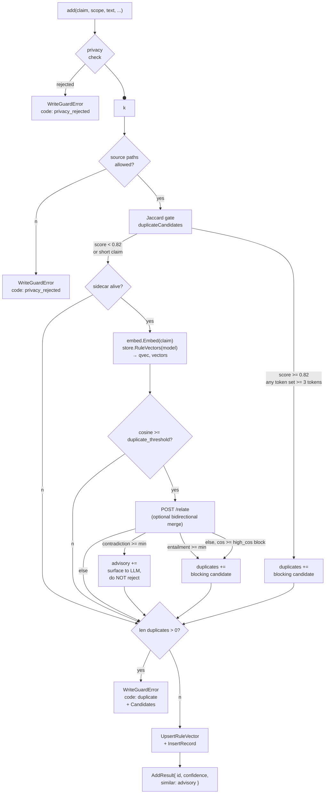
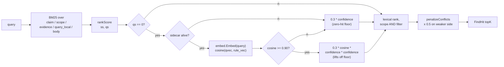

# Semantic duplicate gate

The write-time gate that catches paraphrases and topic-near duplicates that
lexical Jaccard misses. Optional: enabled by setting `plugins.embed.enabled: true`
in `imprint.yaml`. When the sidecar is absent or slow, writes degrade silently
back to the lexical path — **the write never blocks on the embedder**.

The gate has two consumers: the **write path** (reject or admit) and the
**read path** (semantic recall lift). Both share the same embedder and the
same vector store.

## Why lexical Jaccard alone is not enough

Jaccard is set intersection over union on the token sets of two claims.
It ignores word order, frequency, and meaning. On the imprint calibration
corpus the duplicates / conflicts / unrelated groups look like this:

| Group     | Median | Min   | Max   | Notes                                                       |
| --------- | ------ | ----- | ----- | ----------------------------------------------------------- |
| Duplicate | 0.823  | 0.652 | 0.932 | "Always X" ↔ "X is required" — same policy, different words |
| Conflict  | 0.753  | 0.492 | 1.000 | "Prefer tabs" ↔ "Prefer spaces" — opposite policy            |
| Unrelated | 0.528  | 0.432 | 0.644 | Different topics                                             |

The acceptance pair
`"Go exported identifiers must use PascalCase"` ↔
`"Exported things use Pascal Case naming"`
scores **Jaccard 0.38** — below the 0.82 reject threshold, so the lexical
path lets it through. The semantic gate catches it (cosine ≈ 0.71 with
`duplicate_threshold` 0.65 and relate entailment, or high cosine fallback
when NLI is neutral — see tuning below).

## Architecture

```
┌──────────────────────────── imprint (Go) ────────────────────────────┐
│                                                                       │
│  pkg/imprint/write_guard.go                                           │
│        │                                                              │
│        │   claims (strings)                                           │
│        ▼                                                              │
│  pkg/imprint/embed.go  (Embedder interface, threshold, model name)     │
│        │                                                              │
│        ▼                                                              │
│  internal/embed/client.go  (HTTP client, 2s timeout, connection pool) │
│        │                                                              │
└────────┼──────────────────────────────────────────────────────────────┘
         │  POST /embed   {"texts":[...], "model":"BAAI/bge-small-zh-v1.5"}
         │  GET  /health
         ▼
┌──── imprint-embed-sidecar (Python, external process) ────────────────┐
│  server.py                                                           │
│      │   ThreadingHTTPServer, lazy model load                      │
│      ▼                                                              │
│  fastembed + onnxruntime                                             │
│      │   BAAI/bge-small-zh-v1.5 (512-dim, ~130MB)                    │
│      ▼                                                              │
│  responses: {"vectors":[[...]], "dim":512, "model":"..."}             │
└─────────────────────────────────────────────────────────────────────┘

                        ┌─────────────────────────────┐
                        │  internal/vault/sqlite      │
                        │  table: rule_vectors        │
                        │  (rule_id, model, dim,      │
                        │   vec BLOB, updated_at)     │
                        └─────────────────────────────┘
```

The Go binary has **no** ONNX / fastembed / sentence-transformers dependency.
Vectors are produced by the sidecar and stored in `rule_vectors`.

## Lifecycle

Embed is a **singleton daemon**. `imprint up` / `down` never start or stop it.
MCP (or `imprint plugin start embed`) owns the process; stop it with
`imprint plugin stop embed`.

| Phase | What happens |
| --- | --- |
| `imprint-mcp` | If `plugins.embed` is enabled: `GET /health` on the configured port. Unhealthy → fork once at MCP start. Healthy → reuse, no second process. Closing the editor does **not** stop the sidecar (no parent watch); the next MCP start reuses it if still healthy. |
| `embed prepare` | **Foreground** download + load of embed and relate weights (full HF/tqdm on your terminal). No HTTP server. Run after setup or when changing models. |
| `plugin start embed` | Always **stop then fork** (kills whoever holds the port). Streams **sidecar.log** to stderr while waiting for `ready`. The new process stays up after the CLI exits. |
| `plugin stop embed` | Frees the configured embed LISTEN port. |
| CLI `add` / `find` | HTTP client only. Never forks. Connection refused → Jaccard. |
| `up` | Starts host / shelves / desk. Does **not** start or stop embed. Probes the port and reports running or a start hint. |
| `down` | Stops host / desk. Leaves embed running. Hint: `imprint plugin stop embed`. |
| steady | Go client reuses HTTP keep-alive; sidecar caches models in RAM after `run.sh` warm |
| cold start | First machine install may download weights into `~/.cache/imprint/models`. Prefer **`imprint embed prepare`** once so downloads show on the terminal; `run.sh` still runs `--warm` before listen on start. `GET /health` includes `"ready": true` when embed+relate are loaded. Until then, treat the gate as degraded (Jaccard-only). When huggingface.co is unreachable, the CLI sets `HF_ENDPOINT=https://hf-mirror.com` and disables HF XET (avoids 401 / hung downloads); override with `IMPRINT_HF_ENDPOINT`. Relate prefetch skips unused ONNX bundles. |
| plugin start / MCP | Waits up to **180s** for embed `ready` (not just HTTP 200). |

There is no crash recovery. MCP probes once at process start and does not
restart a sidecar killed later. The write path degrades to Jaccard if the
sidecar dies mid-session.

## Write-time gate

Every `add` call runs the same sequence. Each gate is independent; the
write is blocked when `len(duplicates) > 0`.



### Gate-by-gate specification

| # | Gate             | Threshold | Hard reject. | Sidecar dep. | What it catches              |
| - | --------------- | --------- | ------------ | ------------ | ---------------------------- |
| 1 | privacy check   | regex     | yes          | no           | PII, secrets, credential-like data |
| 2 | source paths    | allowlist | yes          | no           | denied paths / non-vault writes     |
|  3 | Jaccard         | 0.82      | yes          | no           | near-identical wording        |
|  4 | cosine          | `duplicate_threshold` (default 0.65) | enters relate pool | yes | paraphrases, restructured sentences |
|  5 | relate (NLI)    | `relate_*_min` in yaml | entail → block; contradiction → advisory | yes | opposite policy pairs |
|  6 | high cosine     | `duplicate_high_cosine_block` (0 = off) | block when NLI neutral but cos very high | yes | `%w`/gofmt-style paraphrases |

**Decision order (Go, after cosine ≥ threshold):** contradiction ≥
`relate_contradiction_min` → **advisory**; else entailment ≥
`relate_entailment_min` → **block**; else if `duplicate_high_cosine_block` > 0
and cosine ≥ that value → **block**; else pass. With
`relate_bidirectional: true`, forward and reverse `/relate` scores merge
(max contradiction, max entailment) before this logic. Thresholds live in
`imprint.yaml` only — the sidecar returns scores, not decisions.

### Calibration

Run `imprint-embed-sidecar/calibrate.py` for grid picks on
`duplicate_threshold`, `relate_contradiction_min`, and `relate_entailment_min`.
Run `imprint-embed-sidecar/eval_gate.py --bidirectional --high-cos-block …`
on the same 60-pair sample set to tune `duplicate_high_cosine_block` (typical
**0.80** for full duplicate recall with zero conflict false-blocks on samples).
Run `scripts/embed-eval-batch.py` for end-to-end `imprint add` checks.
**Do not change knobs without re-running these on your model.**

### Relate gate — embed sidecar `POST /relate`

After cosine (or high Jaccard) similarity, Go batches claim pairs to the
sidecar. The sidecar returns softmax probabilities (typically
`contradiction`, `neutral`, `entailment`) from a configurable cross-encoder
(`relate_model` in `imprint.yaml`, default `cross-encoder/nli-deberta-v3-base`).
**Thresholds live only in imprint.yaml** — the sidecar does not decide
duplicate vs advisory.

Install: clone [imprint-embed-sidecar](https://github.com/SteamedBread2333/imprint-embed-sidecar),
run `./scripts/setup.sh` (venv under `~/.imprint/plugins/embed/venv`), and set
`plugins.embed.package` to that repo path (e.g. `../imprint-embed-sidecar`).
Run `calibrate.py` after model changes.

## Advisory path — `AddResult.Similar`

When cosine/Jaccard is high but `/relate` contradiction ≥
`relate_contradiction_min`, the candidate lands in `AddResult.Similar` instead
of `duplicates`.
**The write succeeds**, the LLM is expected to surface the conflict to the
user and call `link --conflicts` (or `supersede` / `forget`).

```json
{
  "id": "r-2026-09-23-005",
  "confidence": 0.6,
  "path": "...",
  "similar": [
    { "id": "r-2026-09-23-003", "score": 0.927, "claim": "Use tabs for indentation" }
  ]
}
```

| Consumer of `similar` | What it does                                          |
| --------------------- | ----------------------------------------------------- |
| LLM agent             | Asks the user; on consent calls `link --conflicts`    |
| `find` / `rankScore`  | Ignores it — advisories are write-only                |
| Telemetry             | Emits `Op: "embed_advisory"` with the rule-hit count  |

**There is no automatic resolution.** The relate gate's job is to
prevent a hard reject, not to decide for the user.

## Read-time semantic recall

`find --query "..."` falls back to a zero-lexical-hit floor when nothing
matches lexically. The semantic gate raises the floor when cosine ≥ 0.90
(above the duplicate threshold) — **lexical hits always outrank semantic
ones**, this layer only rescues rules the BM25 pass missed.



A semantic recall lift **always ranks below** a lexical hit. The semantic
layer is rescue-only: it surfaces what BM25 missed, not what BM25 found.
No relate gate at read time — an opposing-policy pair is still useful context
for the agent to see; we let the LLM arbitrate which to follow.

## Silent degradation

Every embed call is bounded by `embedTimeout = 2s`. The semantics:

| sidecar state                | write gate behavior                                  |
| ---------------------------- | ---------------------------------------------------- |
| enabled, healthy             | full Jaccard + cosine + relate stack               |
| enabled, call times out      | Jaccard only; telemetry `Op: "embed_unavailable"`     |
| enabled, sidecar crashed     | Jaccard only (the next call reconnects or fails)     |
| disabled (`enabled: false`)  | Jaccard only; no telemetry                           |

**A write never fails because the sidecar is unavailable.** That is the
single invariant this subsystem promises. The write degrades in
precision — paraphrases and restructured duplicates slip through —
but never in availability.

`TestEmbedUnavailableStillWrites` is the regression test. The acceptance
scenario 12 of `cmd/imprint-acceptance` also exercises this path.

## What is stored where

| Lives in                                | Contents                                                     |
| --------------------------------------- | ------------------------------------------------------------ |
| `<vault>/vault.db` (table `rule_vectors`; default under `~/.imprint/projects/<hash>/`) | (rule_id, model, dim, vec BLOB, updated_at)              |
| `~/.cache/imprint/models/`              | ONNX model weights, ~130MB for `BAAI/bge-small-zh-v1.5`      |
| `~/.imprint/plugins/embed/venv`         | Python venv with fastembed + onnxruntime                     |

The vector stays with the vault (project-local) so the gate works on
global + project vaults. Model weights and venv live under the user
home and are shared across all imprint vaults.

## Single-instance constraint

The embed sidecar is a **singleton** — one process, one model, one port
(4174). This is an architectural ceiling, not a bug, and it is worth
naming explicitly because it bounds what users can do with embed.

**What every imprint vault gets, regardless of project:**

- one shared model (`BAAI/bge-small-zh-v1.5`) — the `rule_vectors.model`
  column in every vault must match this value
- one shared port (4174) — only one embed process can be alive at a time
- one shared 512-dim vector space — all cosine comparisons assume the
  same model emitted both vectors

**Why this is fine and never "crosses wires" between projects:**

1. The sidecar is a pure inference service. It never reads a vault,
   never queries a rule, never carries per-project state. Two CLI calls
   from two different project directories both produce the same answer for
   the same text.
2. Vectors are stored in the project vault SQLite file (table
   `rule_vectors`; default `~/.imprint/projects/<hash>/vault.db`). Each
   vault is a separate SQLite file; vectors do not share one cross-project
   database.
3. The Go code that consumes vectors (`mergeEmbedDuplicatesVec`,
   `rankScore`) reads only the calling process's own vault, so project A's
   `find` never sees project B's `rule_vectors`.

**What single-instance forbids, and how to work around it:**

| Constraint                                        | Workaround                                            |
| ------------------------------------------------- | ----------------------------------------------------- |
| Cannot serve different models per vault           | All vaults share `BAAI/bge-small-zh-v1.5`; switching models orphans every `rule_vectors` row in every vault and triggers a full backfill |
| Cannot run two embers with different models on the same machine | One model wins; the loser writes its configurations and gets a clear 2s timeout error on every embed call |
| Cannot query vectors across vaults (different per-vault `model`) | Cross-vault find is not supported; if you need it, the rule data itself must move (e.g. global personal vault), not the vector store |

**Operational rules:**

- One `imprint-embed-sidecar` process per machine, no matter how many
  vaults or projects live under the user's home. Only one listener can
  bind 4174 (or `plugins.embed.config.port`).
- `imprint-mcp` **reuses** a healthy listener: the startup health probe
  returns and it does not fork.
- `imprint plugin start embed` does **not** reuse: it stops whatever
  holds that port, then forks a new process.
- `imprint up` and `imprint down` do **not** touch embed. Start or stop
  it only with `imprint plugin start embed` / `imprint plugin stop embed`.
- If you ever need multi-model support (bge-small + OpenAI text-embedding-3
  + Cohere, say), the sidecar must be re-architected as a **router**
  that spawns or proxies per-model child processes. That is out of scope
  for the current single-model design.

## Trace correlation

Every event the gate emits carries a `trace_id` (12 hex chars from
crypto/rand). One `add` call produces a trace like:

```
add  trace=873d4cb1895d
├─ embed_unavailable     (skipped if sidecar healthy)
├─ embed_advisory        (relate contradiction advisory)
├─ embed                 (always, on healthy path)
└─ add                   (final event)
```

If you see an `embed_advisory` event with no follow-up `link` event from
the agent, that is a signal the agent skipped the contract step — the
antonym pair sits in the vault without a `conflicts_with` edge and the
conflict-penalty logic in `find` is dormant for that pair.

## Tuning

| Knob                                | Default | Where                          | Notes                                                       |
| ----------------------------------- | ------- | ------------------------------ | ----------------------------------------------------------- |
| `plugins.embed.duplicate_threshold` | 0.65 | `imprint.yaml` | `calibrate.py` grid |
| `plugins.embed.relate_contradiction_min` | 0.40 | `imprint.yaml` | At or above → advisory |
| `plugins.embed.relate_entailment_min` | 0.35 | `imprint.yaml` | At or above → block (if contradiction low) |
| `plugins.embed.relate_bidirectional` | true | `imprint.yaml` | Merge forward + reverse `/relate` |
| `plugins.embed.duplicate_high_cosine_block` | 0.80 | `imprint.yaml` | **0** disables; tune with `eval_gate.py` |
| `plugins.embed.relate_model` | `cross-encoder/nli-deberta-v3-base` | `imprint.yaml` | Sidecar loads from HF cache |
| `plugins.embed.timeout_seconds` | 5 | `imprint.yaml` | Per embed/relate HTTP call |
| `plugins.embed.port` | 4174 | `imprint.yaml` | Must match sidecar listen |
| `plugins.embed.model` | `BAAI/bge-small-zh-v1.5` | `imprint.yaml` | Keys `rule_vectors.model` |

Go defaults mirror yaml when fields are omitted (`pkg/imprint/embed.go`).

## Re-calibration

After a model or sidecar upgrade:

1. `calibrate.py` — cosine + relate grid for T / C / E  
2. `eval_gate.py --bidirectional --high-cos-block 0.80` — full 60-pair semantic gate  
3. `IMPRINT_BIN=imprint python3 scripts/embed-eval-batch.py` — vault `add` regression