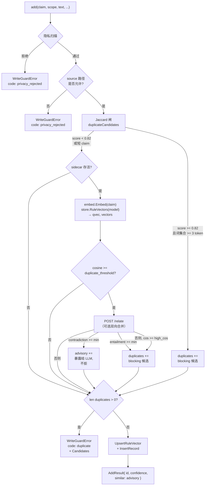
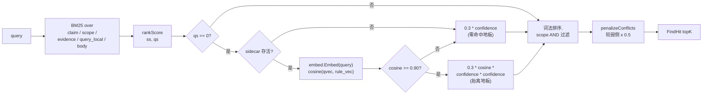

# 语义去重门禁

抓词面 Jaccard 抓不到的改述和话题相近的重复写入。**可选**：在 `imprint.yaml` 设 `plugins.embed.enabled: true` 启用。sidecar 缺席或慢时静默降级回词面路径——**写入永远不会因 embedder 而阻塞**。

门禁有两个消费者：**写路径**（拒或放）和**读路径**（语义召回抬升）。两者共用同一个 embedder 和同一个向量存储。

## 为什么仅词面 Jaccard 不够

Jaccard 是两个 claim 词集合的交集除以并集。它忽略词序、词频、词义。在 imprint 的标定语料上三组数据：

| 组       | 中位数 | 最小   | 最大   | 备注                                                       |
| -------- | ------ | ----- | ----- | ---------------------------------------------------------- |
| 真重复   | 0.823  | 0.652 | 0.932 | "Always X" ↔ "X is required"——同一政策不同词面         |
| 反义冲突 | 0.753  | 0.492 | 1.000 | "Prefer tabs" ↔ "Prefer spaces"——对立政策               |
| 无关     | 0.528  | 0.432 | 0.644 | 不同话题                                                   |

验收对
`"Go exported identifiers must use PascalCase"` ↔
`"Exported things use Pascal Case naming"`
**Jaccard 0.38**——低于 0.82 拒门，词面路径放行。语义门禁用 `duplicate_threshold`（默认 0.65）+ relate；NLI 偏 neutral 时还可靠 `duplicate_high_cosine_block`（见调优）。

## 架构

```
┌──────────────────────────── imprint (Go) ────────────────────────────┐
│                                                                       │
│  pkg/imprint/write_guard.go                                           │
│        │                                                              │
│        │   claims (字符串)                                            │
│        ▼                                                              │
│  pkg/imprint/embed.go  (Embedder 接口、阈值、模型名)                  │
│        │                                                              │
│        ▼                                                              │
│  internal/embed/client.go  (HTTP 客户端，2s 超时，连接池)            │
│        │                                                              │
└────────┼──────────────────────────────────────────────────────────────┘
         │  POST /embed   {"texts":[...], "model":"BAAI/bge-small-zh-v1.5"}
         │  GET  /health
         ▼
┌──── imprint-embed-sidecar (Python，外部进程) ────────────────────────┐
│  server.py                                                           │
│      │   ThreadingHTTPServer，懒加载模型                            │
│      ▼                                                              │
│  fastembed + onnxruntime                                             │
│      │   BAAI/bge-small-zh-v1.5 (512 维，~130MB)                    │
│      ▼                                                              │
│  响应: {"vectors":[[...]], "dim":512, "model":"..."}                  │
└─────────────────────────────────────────────────────────────────────┘

                        ┌─────────────────────────────┐
                        │  internal/vault/sqlite      │
                        │  表: rule_vectors           │
                        │  (rule_id, model, dim,      │
                        │   vec BLOB, updated_at)     │
                        └─────────────────────────────┘
```

Go 二进制**没有** ONNX / fastembed / sentence-transformers 任何依赖。向量由 sidecar 产生，落库到 `rule_vectors`。

## 生命周期

embed 是**单例 daemon**。`imprint up` / `down` 既不起也不停。进程由 MCP（或 `imprint plugin start embed`）管；停它用 `imprint plugin stop embed`。

| 阶段 | 发生了什么 |
| --- | --- |
| `imprint-mcp` | `plugins.embed` 启用时：对配置端口 `GET /health`。不健康 → MCP 启动时 fork 一次。已健康 → 复用，不拉第二个进程。关编辑器**不会**停 sidecar（没有 parent watch）；下次 MCP 启动时若仍健康就复用。 |
| `embed prepare` | **前台**下载并加载 embed + relate 权重（终端可见 HF/tqdm 进度），不起 HTTP。新机或换模型后跑一次。 |
| `plugin start embed` | **每次先 stop 再 fork**（端口上无论谁在听都会被杀）。等待 `ready` 期间把 **sidecar.log** 流到 stderr。CLI 退出后新进程继续活着。 |
| `plugin stop embed` | 清掉配置端口上的 LISTEN 进程。 |
| CLI `add` / `find` | 只打 HTTP，不 fork。连接拒绝 → Jaccard。 |
| `up` | 起 host / shelves / desk。**不起也不停** embed。探测端口：在跑就报 running，否则给 start 提示。 |
| `down` | 停 host / desk。embed 继续跑。提示：`imprint plugin stop embed`。 |
| 稳态 | Go 客户端复用 keep-alive；`run.sh` warm 后 sidecar 在内存缓存 embed + relate |
| 冷启动 | 新机首次可能把权重下到 `~/.cache/imprint/models`。建议先 **`imprint embed prepare`** 看全下载进度；`plugin start` 时 `run.sh` 仍会 **--warm**。`GET /health` 的 **`ready: true`** 表示可接 write。未 ready 时按降级（仅 Jaccard）。国内网络：CLI 在访问不了 huggingface.co 时会自动设 `HF_ENDPOINT=https://hf-mirror.com`，并关闭 HF XET（否则大文件会 401/假死）；也可手动 `export IMPRINT_HF_ENDPOINT=https://hf-mirror.com` |
| plugin start / MCP | 最多等 **180s** 直到 embed **`ready`**（不是只看 HTTP 200） |

无崩溃恢复。MCP 只在进程启动时 probe 一次，之后被杀掉不会自动再起。中途挂掉写路径直接降级回 Jaccard。

## 写时门禁

每次 `add` 都跑同一序列。各闸独立，**任意闸命中 blocking 即拒**：



### 各闸规格

| # | 闸        | 阈值     | 是否硬拒 | 是否依赖 sidecar | 抓什么                       |
| - | --------- | -------- | -------- | ---------------- | ---------------------------- |
| 1 | 隐私扫描 | 正则     | 是       | 否               | PII、密钥、凭据式数据         |
| 2 | source 路径 | 白名单 | 是       | 否               | 禁用路径、vault 外的写入       |
| 3 | Jaccard   | 0.82     | 是       | 否               | 词面高度重合                  |
| 4 | 余弦 | `duplicate_threshold`（默认 0.65） | 进入 relate 池 | 是 | 改述、句式重构 |
| 5 | relate | `relate_*_min` | entail → 拒写；contradiction → advisory | 是 | 对立政策 |
| 6 | 高余弦 | `duplicate_high_cosine_block`（0=关） | NLI neutral 但 cos 极高仍拒写 | 是 | 如 `%w`/gofmt 改述 |

**判定顺序（Go）：** contradiction ≥ `relate_contradiction_min` → advisory；否则 entailment ≥ `relate_entailment_min` → 拒写；否则若 `duplicate_high_cosine_block` > 0 且 cosine ≥ 该值 → 拒写。`relate_bidirectional: true` 时正反 `/relate` 取 max(contradiction/entailment) 再判定。阈值只在 `imprint.yaml`；sidecar 只出分。

### 标定

`calibrate.py` 扫 T/C/E；`eval_gate.py --bidirectional --high-cos-block …` 在 60 对样本上扫高余弦兜底（样本集上 **0.80** 常见）；`scripts/embed-eval-batch.py` 做真实 `add` 回归。换模型后三者至少跑前两个。

### Relate 闸 —— sidecar `POST /relate`

余弦（或高 Jaccard）之后，Go 把 claim 对 batch 到 sidecar；返回 cross-encoder 的
contradiction / entailment 等概率。**阈值只在 imprint.yaml**，sidecar 不做裁决。

安装：clone [imprint-embed-sidecar](https://github.com/SteamedBread2333/imprint-embed-sidecar)，在本仓库跑 `./scripts/setup.sh`，`imprint.yaml` 里 `plugins.embed.package` 指向该目录（如 `../imprint-embed-sidecar`）。改模型后重跑 `calibrate.py`。

## Advisory 旁路 —— `AddResult.Similar`

相似度高但 `/relate` contradiction ≥ `relate_contradiction_min` 时，候选进 `AddResult.Similar` 而非 `duplicates`。**写入成功**，期待 LLM 暴露冲突并调 `link --conflicts`（或 `supersede` / `forget`）。

```json
{
  "id": "r-2026-09-23-005",
  "confidence": 0.6,
  "path": "...",
  "similar": [
    { "id": "r-2026-09-23-003", "score": 0.927, "claim": "Use tabs for indentation" }
  ]
}
```

| `similar` 的消费者 | 做了什么                                              |
| ------------------ | ----------------------------------------------------- |
| LLM agent          | 问用户；同意则调 `link --conflicts`                    |
| `find` / `rankScore` | 忽略——advisory 只在写路径生效                        |
| Telemetry          | 发 `Op: "embed_advisory"`，附 rule-hit 数量           |

**没有自动裁决机制。** 极性闸的职责是阻止硬拒，不是替用户决策。

## 读路径的语义召回

`find --query "..."` 在词法零命中时落到一个地板分数。语义闸在余弦 ≥ 0.90（高于去重阈值）时把地板抬起来——**词法命中永远排在语义命中前面**，这一层只救 BM25 漏的：



语义召回抬升**永远排在词法命中后面**。语义层只做"救援"，不抢词法风头。读路径**没有极性闸**——反义对给 agent 看是有用的上下文，让 LLM 仲裁"该信哪个"。

## 静默降级

每次 embed 调用受 `embedTimeout = 2s` 限制。语义：

| sidecar 状态                  | 写门禁行为                                       |
| ----------------------------- | ------------------------------------------------ |
| 启用 + 健康                   | 完整 Jaccard + 余弦 + 极性栈                      |
| 启用 + 调用超时                | 仅 Jaccard；telemetry `Op: "embed_unavailable"`   |
| 启用 + sidecar 中途崩         | 仅 Jaccard（下一次调用重连或失败）               |
| 禁用（`enabled: false`）       | 仅 Jaccard；无 telemetry                          |

**写入永远不会因 sidecar 不可用而失败**——这是本子系统唯一的不变量。写入精度会降（改述和重构的重复会漏），可用性永远保。

`TestEmbedUnavailableStillWrites` 是回归测试。`cmd/imprint-acceptance` 验收场景 12 也跑这条路径。

## 数据落在哪里

| 落在                                | 内容                                                        |
| ----------------------------------- | ----------------------------------------------------------- |
| `<vault>/vault.db`（表 `rule_vectors`；默认在 `~/.imprint/projects/<hash>/`） | (rule_id, model, dim, vec BLOB, updated_at)              |
| `~/.cache/imprint/models/`          | ONNX 模型权重，`BAAI/bge-small-zh-v1.5` 约 130MB           |
| `~/.imprint/plugins/embed/venv`     | 含 fastembed + onnxruntime 的 Python venv                    |

向量随 vault 走（项目-local），所以门禁在 global + project vault 都生效。模型权重和 venv 在用户家目录下，所有 imprint vault 共享。

## 单实例约束

embed sidecar 是**单例**——一个进程、一个模型、一个端口（4174）。这是**架构上限**而不是 bug，但值得显式写下来，因为它界定了 embed 能做什么。

**所有 imprint vault 都共享：**

- 一个模型（`BAAI/bge-small-zh-v1.5`）——每个 vault 的 `rule_vectors.model` 列必须等于这个值
- 一个端口（4174）——同一时刻只能有一个 embed 进程在跑
- 一个 512 维向量空间——所有 cosine 比较都假设两边向量出自同一模型

**为什么不会"项目间窜台"：**

1. sidecar 是纯推理服务。**它不读任何 vault，不查任何规则，不带任何项目状态**。两个不同项目目录的 CLI 调用，对同一段文本返回相同的向量。
2. 向量存在项目 vault 的 SQLite 文件中（表 `rule_vectors`；默认 `~/.imprint/projects/<hash>/vault.db`）。每个 vault 是独立的 SQLite 文件，向量不共用跨项目库。
3. 消费向量的 Go 代码（`mergeEmbedDuplicatesVec`、`rankScore`）**只读调用进程自己的 vault**——项目 A 的 `find` 永远不会看到项目 B 的 `rule_vectors`。

**单实例禁掉了什么 + 怎么绕：**

| 约束                                       | 绕法                                                                  |
| ------------------------------------------ | --------------------------------------------------------------------- |
| 不能给不同 vault 服务不同模型              | 所有 vault 共享 `BAAI/bge-small-zh-v1.5`；换模型会让所有 vault 的 `rule_vectors` 全部失效，需全量 backfill |
| 不能在同一台机起两个不同模型的 embed       | 只有一个模型胜出；输的那个配的 embed 配置照常，但每次 embed 调用都拿 2s 超时错误 |
| 不能跨 vault 做向量查询（不同 vault 模型不同） | 不支持跨 vault find；想跨项目查，得动 **规则数据**本身（如全局 personal vault），不是动向量层 |

**运维铁律：**

- 一台机器只有一个 `imprint-embed-sidecar` 进程，不管用户家目录下挂了多少 vault 和项目。4174（或 `plugins.embed.config.port`）同一时刻只能有一个监听者。
- `imprint-mcp` **会复用**已健康的监听：启动时 health probe 通过就 return，不 fork。
- `imprint plugin start embed` **不会复用**：先停掉占着该端口的进程，再 fork 一个新的。
- `imprint up`、`imprint down` **都不碰** embed。起停只用 `imprint plugin start embed` / `imprint plugin stop embed`。
- 真要支持多模型（比如 bge-small + OpenAI text-embedding-3 + Cohere），sidecar 必须改造成**路由器**——按模型分派或代理到子进程。当前不在范围。

## Trace 串链路

门禁发的每个事件都带 `trace_id`（crypto/rand 出的 12 hex 字符）。一次 `add` 的 trace 链：

```
add  trace=873d4cb1895d
├─ embed_unavailable     （sidecar 不健康时跳过）
├─ embed_advisory        （relate contradiction 高时）
├─ embed                 （健康路径总发）
└─ add                   （最终事件）
```

看到 `embed_advisory` 事件但没后续 `link` 事件——是 agent 跳过契约步骤的信号：反义对进了库但没立 `conflicts_with` 边，`find` 的冲突惩罚逻辑对该对静默。

## 调优

| 旋钮                                | 默认值 | 位置                          | 备注                                                       |
| ----------------------------------- | ------ | ----------------------------- | ---------------------------------------------------------- |
| `plugins.embed.duplicate_threshold` | 0.65 | `imprint.yaml` | `calibrate.py` |
| `plugins.embed.relate_contradiction_min` | 0.40 | `imprint.yaml` | ≥ → advisory |
| `plugins.embed.relate_entailment_min` | 0.35 | `imprint.yaml` | ≥ → 拒写（contradiction 低时） |
| `plugins.embed.relate_bidirectional` | true | `imprint.yaml` | 正反 relate 合并 |
| `plugins.embed.duplicate_high_cosine_block` | 0.80 | `imprint.yaml` | **0** 关闭；`eval_gate.py` 调 |
| `plugins.embed.relate_model` | `nli-deberta-v3-base` | `imprint.yaml` | cross-encoder |
| `plugins.embed.timeout_seconds` | 5 | `imprint.yaml` | 单次 HTTP |
| `plugins.embed.port` | 4174 | `imprint.yaml` | 与 sidecar 一致 |
| `plugins.embed.model` | `BAAI/bge-small-zh-v1.5` | `imprint.yaml` | `rule_vectors` key |

缺省值见 `pkg/imprint/embed.go`。

## 重标定

1. `calibrate.py` — T/C/E  
2. `eval_gate.py --bidirectional --high-cos-block 0.80`  
3. `python3 scripts/embed-eval-batch.py` — vault 回归